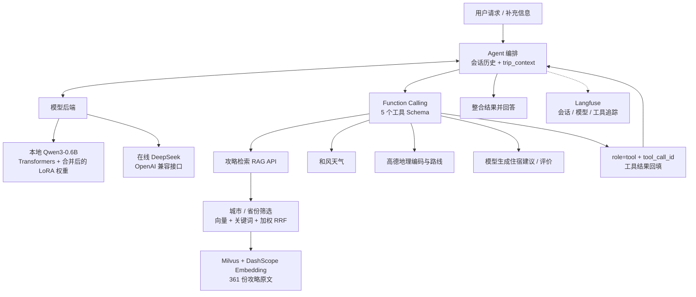
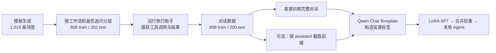

# TravelNova

**把 Qwen3-0.6B 微调成能追问、调用工具、读取检索结果的本地旅行 Agent。**

TravelNova 围绕旅行规划、天气、路线和住宿需求，实现了从 **场景构造 → 工具调用轨迹采集 → LoRA SFT → 权重合并 → 本地 Agent 推理 → 运行追踪** 的完整流程。项目使用 Python 实现工具编排，支持本地 Qwen3 与在线 DeepSeek 两种模型后端，并通过 RAG 接入城市攻略知识。

## 微调实战：三篇文章

按下面的顺序，可以从数据构造一路读到训练原理和 Agent 联调。三篇全文也已收录在仓库中。

| 阶段 | 博客文章 | GitHub 全文 |
| --- | --- | --- |
| ① 数据构造 | [旅行助手的微调数据是怎么来的：从场景生成到工具调用轨迹](https://wywzixin.github.io/agent/travel-assistant-sft-data/) | [数据流水线](travel-assistant-sft-data-pipeline.md) |
| ② LoRA 原理与实现 | [LoRA 是怎么接进旅行助手的：Qwen3-0.6B 微调脚本拆解](https://wywzixin.github.io/agent/qwen3-lora-training/) | [训练代码拆解](qwen3-lora-training-core.md) |
| ③ 训练与 Agent 联调 | [旅行助手中的大模型微调：从 Qwen3-0.6B 到可调用工具的本地 Agent](https://wywzixin.github.io/agent/travel-assistant-finetuning/) | [端到端实践](travel-assistant-llm-finetuning.md) |

## 项目亮点

- **用执行轨迹训练 Agent 行为**：从 1,010 条结构化场景出发，运行助手并保存追问、工具选择、参数、工具结果和最终回复，构建可用于 SFT 的多角色对话。
- **把监督目标落实到 token**：通过 Qwen Chat Template 和 assistant 区间标签掩码，支持所有 assistant 轮次监督、最后一轮监督，以及对话前缀扩展。
- **在消费级显卡上完成微调实践**：基于 Qwen3-0.6B、PEFT LoRA、FP16 和梯度累积，已有 RTX 4060 上 101 个优化步、约 25 分钟的训练记录。
- **让训练产物回到真实应用**：合并 LoRA 后，通过 OpenAI 风格的本地适配层接回同一套工具编排，解析 `<tool_call>`，回填工具结果并继续生成。
- **知识检索与运行观测同时接入**：361 份城市攻略、Milvus 检索、关键词与向量的加权 RRF 融合，以及 Langfuse 的会话、模型和工具调用追踪。

## 能做什么

| 场景 | 实现方式 |
| --- | --- |
| 旅行规划 | 识别目的地、日期和天数，查询攻略，并按需继续查询天气，整合成建议 |
| 多轮追问 | 信息不足时追问；用 `trip_context` 保存目的地、天数和日期，衔接用户的简短补充 |
| 城市攻略 | `search_travel_guide` 调用 RAG API，支持城市/省份筛选、语义和关键词检索 |
| 天气查询 | `get_weather_info` 接入和风天气，按地点和日期查询，受服务的预报范围限制 |
| 路线查询 | `query_route` 接入高德地理编码及步行、公交、驾车路线 |
| 住宿辅助 | `recommend_hotels`、`get_hotel_reviews` 由模型生成推荐与评价摘要，含模拟数据回退，使用前需核实信息 |
| 旅行闲聊与边界处理 | 数据中包含旅行相关闲聊和非旅行请求拒答两类工作流 |
| 调用追踪 | Langfuse 关联 session、Agent、LLM 和工具记录，并对敏感字段脱敏 |

## 系统架构



核心入口是 [`travel_assistant_funcall_fixed.py`](travel_assistant_funcall_fixed.py)。模型返回结构化 `tool_calls` 后，编排层执行对应函数，将结果以 `role=tool` 和相应的 `tool_call_id` 接回上下文；攻略和酒店场景可继续第二轮工具调用，再生成最终回复。

[`local_qwen.py`](local_qwen.py) 将 Transformers 本地推理封装成 `client.chat.completions.create(...)` 风格的接口。它通过 `apply_chat_template` 传入工具定义，默认关闭 thinking、使用确定性解码，并将模型输出中的 `<tool_call>` 解析成编排层需要的响应对象。模型实例按路径复用，生成过程通过线程锁串行执行。

RAG 负责为回答提供攻略内容，微调负责学习追问、调用格式和工作流行为。当前知识库以攻略文件为记录，携带城市和省份元数据，使用 `text-embedding-v4` 的 1,024 维向量；Embedding 输入截取前 8,192 个字符。检索服务提供位置优先匹配、向量与 jieba 关键词召回、加权 RRF 融合及阈值筛选。

## 微调怎么做

### 1. 从业务场景构造工具调用轨迹



[`generate_dataset.py`](generate_dataset.py) 组合城市、日期、用户上下文、问题和追问答案，覆盖旅行规划、问路、酒店、旅行闲聊、非旅行拒答五类工作流。[`split_dataset.py`](split_dataset.py) 使用随机种子 42，按“工作流 + 是否追问”分层，以 80:20 切分。

随后，[`convert_dataset_final_fixed.py`](convert_dataset_final_fixed.py) 实际调用助手与工具，记录运行轨迹，支持并发转换和分批保存。典型样本的消息结构为：

```text
system（用户上下文与任务规则）
  → user（旅行需求）
  → assistant（tool_calls：工具名 + JSON 参数）
  → tool（与 tool_call_id 对应的工具结果）
  → assistant（后续调用或最终回答）
```

工具定义通过样本的 `tools` 字段或训练脚本的 `--tools_file` 注入模板。涉及追问的样本还包含额外的 assistant / user 轮次。

仓库中的数据统计如下：

| 数据阶段 | 文件 | 记录数 |
| --- | --- | ---: |
| 原始场景 | `travel_assistant_dataset_20250914_112354.json` | 1,010 |
| 训练 / 测试场景 | `travel_assistant_train_dataset.json` / `travel_assistant_test_dataset.json` | 808 / 202 |
| 转换后的训练 / 测试对话 | `merged_train_final.json` / `merged_test_final.json` | 808 / 200 |
| 前缀扩展版本 | `merged_train_final_multiturn.json` | 1,830 |
| 前缀扩展 v2 | `merged_train_final_multiturn_v2.json` | 2,207 |

808 条训练对话中，有 **431 条包含工具调用**。前缀扩展由 [`conversation_splitter.py`](conversation_splitter.py) 实现：有工具消息的对话在每个 assistant 结束处截取一个前缀，最后一个前缀保留三份；没有工具消息的对话原样保留。扩展增加的是监督位置与采样权重，记录数包含重复前缀。

### 2. 明确模型究竟学习哪些 token

[`inspect_qwen_dataset.py`](inspect_qwen_dataset.py) 负责读取 JSON / JSONL，兼容 `conversation` 与 `messages`，套用 tokenizer 的 Chat Template，并通过对话前缀长度定位 assistant 区间。system、user、tool 和 padding 对应的 labels 设为 `-100`，由选中的 assistant 段参与训练损失计算。

| 训练入口 | 监督范围 | 使用方式 |
| --- | --- | --- |
| [`train_qwen_lora.py`](train_qwen_lora.py) | 所有 assistant 段 | 同时监督轨迹中的工具调用、追问和回答；工具 Schema 可放在样本 `tools` 字段 |
| [`train_qwen_last_assistant_lora.py`](train_qwen_last_assistant_lora.py) | 最后一个 assistant 段 | 支持 `--tools_file`；配合前缀扩展，可将中间工具调用变成某个样本的监督目标 |
| [`train_qwen_full_finetune_last_assistant.py`](train_qwen_full_finetune_last_assistant.py) | 最后一个 assistant 段 | 提供全参数微调实验路径 |

**完整轨迹 + 仅最后一轮监督**，主要学习读取上下文后的最终回答；要直接监督前面的工具调用，可以使用所有 assistant 段监督，或使用以工具调用结束的前缀样本。下文记录的实验使用 808 条完整对话，并仅监督最后一个 assistant 段。

超长样本会从头部截断、保留尾部，因此设置 `max_seq_length` 时需要检查 system 和工具定义是否被截掉。训练前可用检查脚本查看实际 token 与监督区域，示例命令见后面的复现步骤。

### 3. LoRA 配置与训练策略

基座为 [Qwen/Qwen3-0.6B](https://huggingface.co/Qwen/Qwen3-0.6B)，通过 PEFT 冻结基座并注入 LoRA，学习权重增量 `ΔW = (α / r) · BA`。

| 配置项 | 当前配置 |
| --- | --- |
| LoRA rank / alpha / dropout | `32` / `64` / `0.05` |
| 注意力层目标模块 | `q_proj`、`k_proj`、`v_proj`、`o_proj` |
| MLP 目标模块 | `gate_proj`、`up_proj`、`down_proj` |
| 训练框架 | Transformers Trainer + PEFT |
| 显存管理 | FP16 / BF16、梯度累积、可选 gradient checkpointing、batch 内动态 padding |
| 微调方式 | 普通 LoRA，完整加载基座；未使用 4-bit 量化 |
| 部署方式 | `merge_and_unload()` 合并权重，保存完整模型和 tokenizer |

### 4. 已完成的训练记录

第三篇文章记录了 RTX 4060 上的一次实验；本地保存的 `trainer_state.json` 与 `adapter_config.json` 对应以下结果：

| 项目 | 记录 |
| --- | --- |
| 数据与监督 | `merged_train_final.json`，808 条，仅最后一个 assistant 段参与 loss |
| Epoch / 学习率 / 最大序列长度 | `1` / `1e-4` / `4096` |
| 单卡 batch / 梯度累积 / 精度 | `1` / `8` / FP16 |
| 优化步数 | **101** |
| 训练耗时 | **1,508.83 秒，约 25.15 分钟** |
| 训练平均 loss | **0.8180** |
| LoRA 适配器文件 | **77.05 MiB** |

这些记录说明训练和产物保存已跑通。工具调用正确率还需要独立评测；当前模板数据包含重复或近似场景，尚未公布去重后的泛化评测与消融结果。

## 运行与复现

以下命令使用 PowerShell，从仓库根目录执行。仓库包含源码、训练数据和三篇文章；模型权重、API 密钥、向量数据库及运行日志需在本地准备。

### 1. 安装和配置

下面安装 LoRA 训练与 Agent 运行所需的依赖，训练库版本与第三篇文章中的环境一致：

```powershell
git clone https://github.com/wywzixin/TravelNova.git
cd TravelNova
conda create -n qwen3-sft python=3.11 -y
conda activate qwen3-sft
python -m pip install "transformers==4.51.0" "datasets==3.6.0" "accelerate==1.6.0" "peft==0.15.2" safetensors sentencepiece
python -m pip install openai requests pandas numpy tqdm "pymilvus[milvus_lite]>=2.4.0" flask jieba python-dotenv "langfuse>=4.0.0"
Copy-Item .env.example .env
```

训练需要安装与显卡驱动匹配的 [CUDA 版 PyTorch](https://pytorch.org/get-started/locally/)。在 `.env` 中填写实际使用的服务：

| 配置 | 用途 |
| --- | --- |
| `DASHSCOPE_API_KEY` | 攻略 Embedding 与查询向量生成 |
| `AMAP_API_KEY` | 高德地理编码和路线 |
| `QWEATHER_API_KEY`、`QWEATHER_API_HOST` | 和风天气，Host 使用自己账号的 API Host |
| `DEEPSEEK_API_KEY` | 在线 DeepSeek 后端 |
| `LANGFUSE_PUBLIC_KEY`、`LANGFUSE_SECRET_KEY` | 可选的调用追踪 |

`.env`、权重、数据库、日志和缓存均由 `.gitignore` 排除。Milvus Lite 的安装取决于平台和版本；也可在可用环境中单独运行 RAG 服务，通过 `RAG_API_URL` 连接。

### 2. 准备基座与检查数据

下载基座到本地模型目录：

```powershell
python -c "from huggingface_hub import snapshot_download; snapshot_download('Qwen/Qwen3-0.6B', local_dir='models/qwen3-0.6b-clean')"
```

使用仓库已有训练数据即可复现训练。先检查最后一轮的监督区域：

```powershell
python .\inspect_qwen_dataset.py `
  --data_file .\merged_train_final.json `
  --model_name_or_path .\models\qwen3-0.6b-clean `
  --max_seq_length 4096 `
  --tools_file .\all_tools.json `
  --only_last_assistant `
  --num_samples 1 `
  --local_files_only
```

重新构造场景、执行工具采集和扩展前缀的流程，见[第一篇文章](travel-assistant-sft-data-pipeline.md)。数据生成会调用模型与外部工具，需要相应配置。

### 3. 复现已记录的 LoRA 实验

```powershell
python .\train_qwen_last_assistant_lora.py `
  --train_file .\merged_train_final.json `
  --model_name_or_path .\models\qwen3-0.6b-clean `
  --output_dir .\outputs\qwen3-0.6b-existing-data-lora `
  --num_train_epochs 1 `
  --learning_rate 1e-4 `
  --max_seq_length 4096 `
  --per_device_train_batch_size 1 `
  --gradient_accumulation_steps 8 `
  --fp16 `
  --local_files_only `
  --tools_file .\all_tools.json
```

若要让最后一轮监督覆盖中间的工具决策，可将 `--train_file` 换成 `merged_train_final_multiturn_v2.json`；这是另一组训练配置，需要单独评测。所有 assistant 段监督的实现和参数说明，见[第二篇文章](qwen3-lora-training-core.md)。

### 4. 合并 LoRA 权重

```powershell
python .\merge_lora_into_base.py `
  --base_model .\models\qwen3-0.6b-clean `
  --adapter_path .\outputs\qwen3-0.6b-existing-data-lora `
  --output_dir .\models\qwen3-0.6b-existing-data-merged `
  --local_files_only `
  --fp16
```

### 5. 启动攻略服务和 Agent

先导入攻略并启动 RAG API：

```powershell
Set-Location .\rag-system
python import_travel_guides.py
python rag_api.py
```

首次导入会请求 Embedding API 并生成 `milvus_store.db`。后续启动直接运行 `rag_api.py`，默认监听 `http://127.0.0.1:8010`。

另开终端，在项目根目录启动本地 Agent：

```powershell
conda activate qwen3-sft
$env:TRAVEL_ASSISTANT_BACKEND = "local_qwen"
$env:LOCAL_QWEN_MODEL_PATH = ".\models\qwen3-0.6b-existing-data-merged"
python travel_assistant_funcall_fixed.py
```

也可设置 `$env:TRAVEL_ASSISTANT_BACKEND = "deepseek"`，使用 `.env` 中的密钥切换在线模型。Windows 一键启动入口为 `start_travel_assistant.bat`，使用 `qwen3-sft` Conda 环境及上述合并模型目录。

例如，可以用“我想去杭州玩三天，帮我安排一下”检查攻略与天气调用，用“我想去旅游”检查追问，用“从当前位置到北京南站怎么走”检查路线工具。运行追踪配置见 [Langfuse 说明](LANGFUSE.md)，RAG 接口见 [RAG 服务说明](rag-system/README.md)。

## 源码导航

| 路径 | 用途 |
| --- | --- |
| [`travel_assistant_funcall_fixed.py`](travel_assistant_funcall_fixed.py) | Agent 入口、上下文管理、五个工具的编排 |
| [`local_qwen.py`](local_qwen.py) | 本地推理、Chat Template、工具调用解析 |
| [`tools/`](tools/) | 天气、路线与生成式酒店辅助 |
| [`rag-system/`](rag-system/) | 361 份攻略原文、向量导入与混合检索 API |
| [`generate_dataset.py`](generate_dataset.py)、[`split_dataset.py`](split_dataset.py) | 场景生成和分层切分 |
| [`convert_dataset_final_fixed.py`](convert_dataset_final_fixed.py) | 运行助手、采集工具调用轨迹 |
| [`conversation_splitter.py`](conversation_splitter.py) | 对话前缀扩展与末轮过采样 |
| [`inspect_qwen_dataset.py`](inspect_qwen_dataset.py) | 模板化、监督标签、动态 padding 和数据检查 |
| [`train_qwen_lora.py`](train_qwen_lora.py)、[`train_qwen_last_assistant_lora.py`](train_qwen_last_assistant_lora.py) | 两种监督策略的 LoRA 训练 |
| [`merge_lora_into_base.py`](merge_lora_into_base.py) | 适配器合并与模型导出 |
| [`all_tools.json`](all_tools.json) | 训练用工具 Schema |
| [`observability.py`](observability.py) | Langfuse 追踪、脱敏、异常降级 |
| [`design/`](design/) | 静态界面设计稿 |
